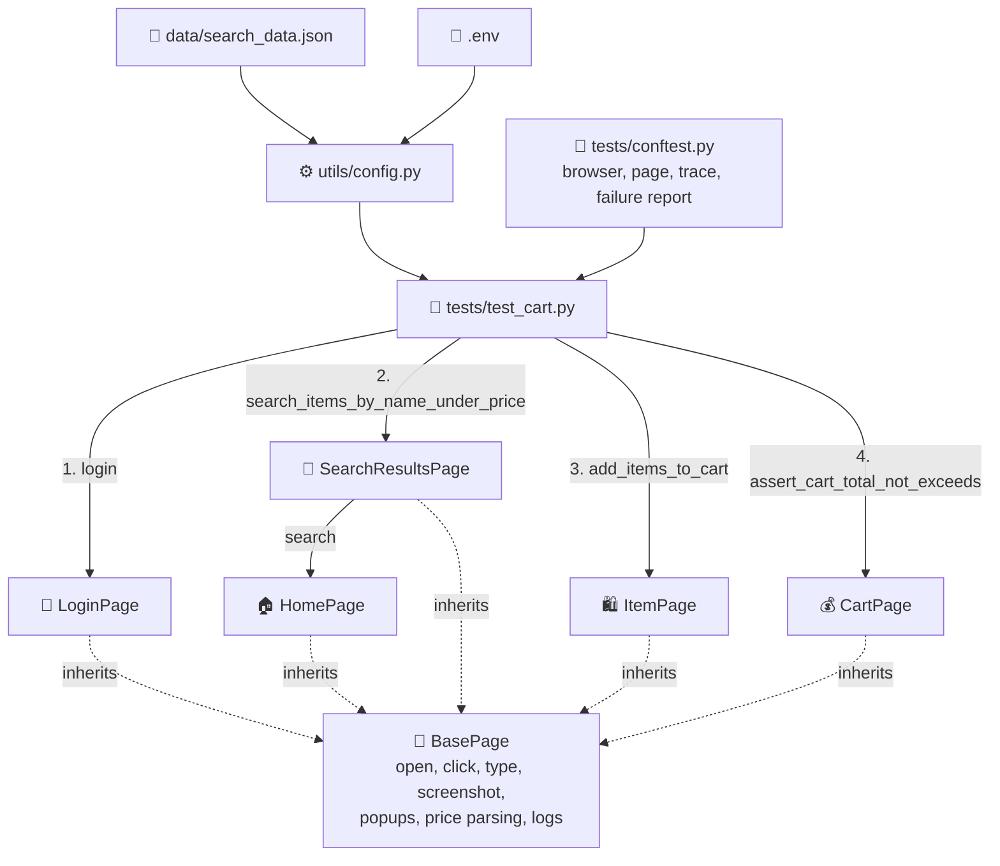

# 🛒 eBay Automation

End-to-end UI test for **eBay** - search items under a price, add them to the cart, and check the cart stays within budget.


[](https://nimrodwe.github.io/ebay-automation/)

[](https://github.com/nimrodwe/ebay-automation/actions/workflows/tests.yml)

🔗 **CI runs:** [GitHub Actions](https://github.com/nimrodwe/ebay-automation/actions/workflows/tests.yml) · 📊 **Latest Allure report:** [nimrodwe.github.io/ebay-automation](https://nimrodwe.github.io/ebay-automation/)

---

## 📑 Table of Contents

- [🎯 What it does](#-what-it-does)
- [🧱 Tech stack](#-tech-stack)
- [🗺️ POM flow](#️-pom-flow)
- [📁 Project structure](#-project-structure)
- [⚙️ Setup](#️-setup)
- [▶️ How to run](#️-how-to-run)
- [📊 Report and outputs](#-report-and-outputs)
- [🤖 GitHub Actions](#-github-actions)
- [⚠️ Limitations and assumptions](#️-limitations-and-assumptions)
- [🐞 AI bugs exercise](#-ai-bugs-exercise)

---

## 🎯 What it does

One e2e scenario, run once for **every row** in `data/search_data.json`:

| # | Step | Function | What happens |
|---|------|----------|--------------|
| 1 | 🔐 Login | `login(credentials)` | Signs in with the account from `.env`. No credentials, CAPTCHA or Error Page → continues as **guest** |
| 2 | 🔎 Search | `search_items_by_name_under_price(query, max_price, limit)` | Searches, sets the **Max price** filter, collects item links (XPath) priced `<= max_price`, moves to the **next page** until it has `limit` items |
| 3 | 🛍️ Add to cart | `add_items_to_cart(urls)` | Opens each item in a new tab, picks **random variants** (size / color / ...), clicks **Add to cart**, takes a 📸 screenshot + 📝 log, back to the search tab |
| 4 | 💰 Budget | `assert_cart_total_not_exceeds(budget_per_item, items_count)` | Opens the cart, takes a 📸 screenshot, asserts the cart holds the items added and `items total <= budget_per_item * items_count` |

The test itself reads like the scenario:

```python
def test_search_add_to_cart_budget(page, credentials, data):
    LoginPage(page).login(credentials)
    search_page = SearchResultsPage(page)
    urls = search_page.search_items_by_name_under_price(data["query"], data["max_price"], data["limit"])
    assert len(urls) <= data["limit"], f"Got {len(urls)} items, limit is {data['limit']}"
    if len(urls) < data["limit"]:
        assert not search_page.next_page_link.is_visible(), f"Got only {len(urls)} items but more result pages exist"
    items_added = ItemPage(page).add_items_to_cart(urls)
    CartPage(page).assert_cart_total_not_exceeds(data["max_price"], items_added)
```

What is asserted:

| Check | Fails when |
|---|---|
| Search limit | More than `limit` items, or fewer while more result pages exist |
| Added to cart | eBay does not confirm an item was added |
| Cart count | The cart does not hold exactly the items that were added |
| Budget | Cart items total is more than `max_price × items added` |

---

## 🧱 Tech stack

| | Tool | Used for |
|---|------|----------|
| 🐍 | Python 3.11+ | Language |
| 🎭 | Playwright (sync API) | Browser automation |
| 🧪 | pytest | Test runner, fixtures, parametrize |
| 📊 | Allure | Report with steps, screenshots, logs, traces |
| 🔑 | python-dotenv | Credentials and settings from `.env` |
| 🔁 | pytest-rerunfailures | One rerun when eBay blocks or doesn't answer (never on a failed assert) |
| 🐳 | Docker | Run everything with one command, no local setup |

---

## 🗺️ POM flow



| Layer | Responsibility |
|-------|----------------|
| 🧪 **Test** | The scenario only - calls the pages, no locators |
| 🔧 **Fixtures** | Opens / closes the browser, records a trace, attaches screenshot + browser log to Allure |
| 📄 **Pages** | One class per eBay page - its locators and its actions |
| 🧩 **BasePage** | Shared actions every page inherits |
| ⚙️ **Config** | URLs, credentials and test data in one place |

---

## 📁 Project structure

```text
ebay-automation/
├── .github/workflows/
│   └── tests.yml               # CI: run tests on push / PR, publish Allure
├── data/
│   └── search_data.json        # test data (query, max_price, limit)
├── pages/
│   ├── base_page.py            # shared actions
│   ├── login_page.py           # sign in / guest
│   ├── home_page.py            # search box
│   ├── search_results_page.py  # price filter, paging, item links
│   ├── item_page.py            # random variants, add to cart, eBay popups
│   └── cart_page.py            # cart total + budget assert
├── tests/
│   ├── conftest.py             # browser fixture, trace, report hook
│   └── test_cart.py            # the e2e test
├── utils/
│   ├── config.py               # .env + JSON loading
│   └── logger.py               # logger per page
├── allure-results/             # results of a green run (open with allure serve)
├── Dockerfile                  # Python + Chromium + virtual screen
├── docker-compose.yml          # one command to build and run
├── .dockerignore
├── .env                        # credentials (not pushed)
├── pytest.ini
├── requirements.txt
├── README.md
└── ReadMeAIBugs.md
```

---

## ⚙️ Setup

There are two ways to run the tests - pick one:

| | Option | You need |
|---|--------|----------|
| 💻 | **Locally** with a Python virtual environment | Python 3.11+ |
| 🐳 | **Docker** | Docker Desktop (running) |

Both need ☕ Java + [Allure CLI](https://allurereport.org/docs/install/) only to view the report.

### 🔑 Configure (optional, both options)

Create a `.env` file in the project root (it is in `.gitignore`, so it is never pushed). Without it, the tests run as **guest**:

```bash
EBAY_USER=your_ebay_user
EBAY_PASS=your_ebay_password
BASE_URL=https://www.ebay.com
HEADLESS=false
```

| Variable | Meaning |
|----------|---------|
| `EBAY_USER`, `EBAY_PASS` | eBay account - leave empty to run as **guest** |
| `BASE_URL` | Default `https://www.ebay.com` |
| `HEADLESS` | Keep `false` - eBay blocks headless Chromium |

If a value contains `$` (common in passwords), wrap it in single quotes - `EBAY_PASS='pa$$word'` - otherwise Docker Compose reads `$...` as a variable and cuts it.

### 📄 Test data

Every row in `data/search_data.json` is a separate test run - add a row to test another search:

```json
[
  {"query": "shoes", "max_price": 220, "limit": 5},
  {"query": "phone case", "max_price": 50, "limit": 3}
]
```

---

## ▶️ How to run

All commands run from the project folder.

### 💻 Option 1 - Locally (virtual environment)

1️⃣ Create and activate a virtual environment:

```bash
python -m venv .venv
```

```bash
.venv\Scripts\activate
```

On macOS / Linux: `source .venv/bin/activate`

2️⃣ Install the packages and the browser:

```bash
pip install -r requirements.txt
```

```bash
playwright install chromium
```

3️⃣ Run all data rows:

```bash
pytest
```

🎯 Or run one data row:

```bash
pytest -k shoes
```

A Chromium window opens and runs the scenario (it runs headed, because eBay blocks headless Chromium).

### 🐳 Option 2 - Docker

No Python or browser install needed. With [Docker Desktop](https://www.docker.com/products/docker-desktop/) running:

```bash
docker compose up --build
```

- The first run builds the image (a few minutes); later runs reuse it.
- The container runs Chromium **headed** inside a virtual screen (`xvfb`), because eBay blocks headless Chromium.
- `.env` is passed in if it exists - without it the tests run as **guest**.
- The results are written to `allure-results/` on your machine.

### 📊 After either option

```bash
allure serve allure-results
```

---

## 📊 Report and outputs

A run writes its outputs to these folders in the project root:

| Output | Where |
|--------|-------|
| 📊 Allure results | `allure-results/` |
| 📄 Generated HTML report | `allure-report/` (after `allure generate`) |
| 📝 Log of every step | console + `logs/test.log` |
| 📸 Screenshot per added item + cart | `screenshots/` and in Allure |
| 🎞️ Playwright trace (on failure) | `traces/` and in Allure |

✅ The results of a green run (**2 passed**) are included in `allure-results/`. Open the report from the project folder:

```bash
allure serve allure-results
```

In the report, open **Suites → tests → test_cart** and click a test to see its steps and screenshots.

A new `pytest` run replaces them with its own results.

📄 Or generate a static HTML report:

```bash
allure generate allure-results -o allure-report --clean
```

🎞️ Open a trace:

```bash
playwright show-trace traces/<test-name>.zip
```

---

## 🤖 GitHub Actions

Every **push** and **pull request** runs the tests on GitHub ([tests.yml](.github/workflows/tests.yml)) and publishes the Allure report to GitHub Pages:

| Step | What happens |
|------|--------------|
| 🧪 Run tests | Installs Python + Chromium, runs `pytest` headed in a virtual screen (`xvfb-run`) |
| 📊 Build report | Builds the Allure report, keeping the history of the last 20 runs |
| 🌐 Publish | Pushes it to the `gh-pages` branch |
| 🔗 Link | The run's **Summary** page shows the report link |

📊 Latest report: [nimrodwe.github.io/ebay-automation](https://nimrodwe.github.io/ebay-automation/) - always the newest run, no login needed. Each run also keeps its own copy, e.g. [/3/](https://nimrodwe.github.io/ebay-automation/3/) (last 20 runs). The report is published even when the tests fail.

One-time setup on GitHub:

1. After the first run, open **Settings → Pages**, set **Source** to *Deploy from a branch*, branch `gh-pages`, folder `/ (root)`.
2. Optional - to sign in, add **Settings → Secrets and variables → Actions** secrets `EBAY_USER` and `EBAY_PASS`. Without them the run is a **guest**.

---

## ⚠️ Limitations and assumptions

| | Topic | Details |
|---|-------|---------|
| 🤖 | **CAPTCHA** | The test never solves a CAPTCHA. If eBay shows one at login, it continues as a **guest** |
| 🖥️ | **Headed only** | eBay serves an *Error Page* to headless Chromium, so the browser runs visible |
| 💱 | **Currency** | eBay shows prices in the local currency (₪ in Israel). `max_price` is compared in that currency |
| 🔢 | **Quantity stays 1** | Only variants eBay requires (size / color / ...) are picked at random. Quantity is not required, and a quantity above 1 broke some eBay listings, so budget = `max_price × items added` |
| ⏭️ | **Items eBay can't add** | A listing with no Add to cart button (Buy It Now / offer only), or where eBay answers "Something went wrong on our end", is skipped with a log and not counted in the budget |
| 🚚 | **Shipping** | The budget check uses the cart's **items total** (product prices only). Shipping is not part of the item price, so it is left out |
| 🌍 | **Live site** | eBay changes results, layout and rate limits often - a run can fail because of eBay, not the code |
| 🛡️ | **Bot protection** | eBay detects automated traffic and answers with an *Error Page* or CAPTCHA, more often when runs are close together. The framework never bypasses it: it signs in only once per run (guest after a CAPTCHA), retries an Error Page twice (2s, 4s), reruns a blocked or hanging test once after 20s (`pytest-rerunfailures`, only on `RuntimeError` / Playwright `TimeoutError` - an assert failure is never rerun), and otherwise fails with a clear `RuntimeError` - an environment failure, never a false green. Wait a few minutes between full runs. In a real project this flow would run against a staging environment or a mock |

---

## 🐞 AI bugs exercise

The code review of the AI-generated test is in 👉 [ReadMeAIBugs.md](ReadMeAIBugs.md)
